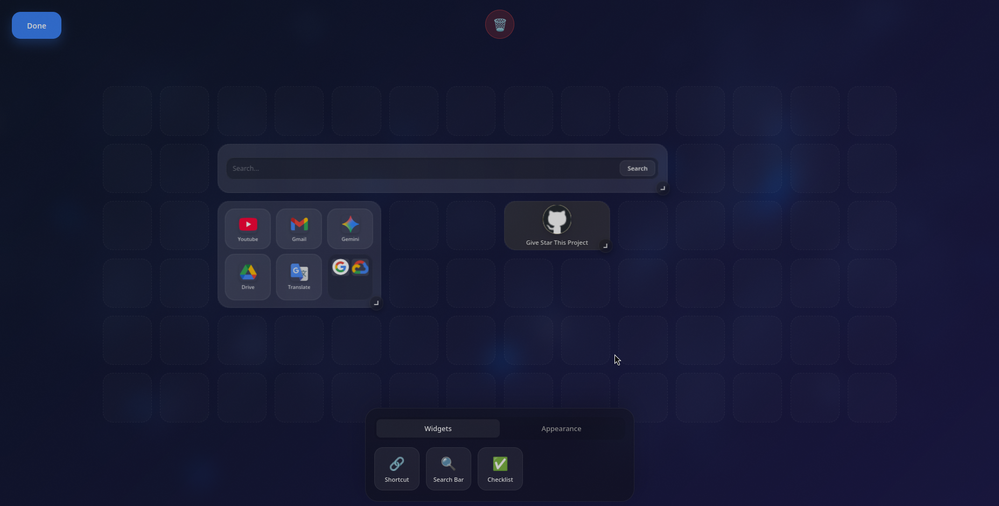

  <h1>🌟 ProGrid Workspace</h1>
  
<b>Version 0.3.0 | Developed by MR Prog</b>

  
A high-performance, modular, and fully customizable dashboard & workspace for web, mobile, and browser extensions.

  
  
  
  
  

  

---

## ✨ Overview

**ProGrid Workspace** is a next-generation new-tab dashboard and progressive web application (PWA) built from the ground up with zero external framework dependencies. It provides an ultra-fluid 60/120fps customizable workspace with instant offline persistence, dual design systems, and modular widgets.

---

## 💎 Key Features & Architecture

### ⚡ 0ms Instant Startup & Offline-First Resilience
- **Smart Stale-While-Revalidate Engine:** Enhanced Service Worker guarantees **100% offline standalone booting** on mobile (iOS/Android) and desktop, with silent background synchronization when connected.
- **Offline Data Preservation:** Market prices, task lists, and notes are cached locally; network outages never wipe out or reset active widget displays.
- **Preload & Asset Caching:** Core scripts, styles, and vector assets load directly from local cache with zero latency.

### 🧩 ProGrid Fluid Matrix Engine (LTS 1.5)
- **Viewport-Aware Geometry:** Grid dynamically balances cell size and gap to maximize screen space across smartphones, tablets, and ultrawide monitors.
- **Zero-Freeze SpringBoard Physics:** Continuous magnetic repulsion, mutual position swapping, and drag-and-drop collision resolution without frame drops.
- **Global Pointer Capture:** Smooth touch and mouse gesture tracking across boundaries, preventing accidental widget freezing or sticky drag states.

### 🎨 Dual Design System
- **Frosted Glass (Default):** Multi-layered translucent surfaces with backdrop blur (`28px`), subtle specular borders, and chromatic depth.
- **Material 3 (Material You):** Clean, solid tonal surfaces with zero-blur elevation, including an integrated **Dark Tone / Light Tone** switcher embedded directly inside the theme configuration.
- **Liquid Glass (Roadmap / Coming Soon):** Physics-based chromatic aberration and dynamic fluid refractions are scheduled for future milestones.

### 📱 Mobile-First Ergonomics
- **Retractable Shelf:** Floating bottom dock for intuitive one-thumb navigation between widget library and appearance controls.
- **Smart Context Menu:** Long-press any widget to trigger quick actions (configure, resize, remove) without cluttering widget viewports.

---

## 📦 Widgets & Community Hub

| Widget | Description | Capabilities |
| :--- | :--- | :--- |
| ⏰ **Clock & Date** | Precision digital clock | 12h/24h formats, Gregorian / Jalali Shamsi / Lunar Hijri calendars, timezone selection |
| 🔍 **Multi-Search** | Instant search bar | Multiple engines (Google, DuckDuckGo, Bing, Brave, Yandex), Pill / Spotlight / Minimal layouts |
| 🔗 **Smart Shortcuts** | Fluid web bookmarks | Custom vector SVG icons, high-res web favicons, rounded shape customization |
| 📁 **Smart Folders** | Grouped shortcut collections | Drag-to-merge, expanded modal preview, instant launch |
| 📈 **Markets & Finance** | Live market tracker | Real-time crypto (BTC, ETH, SOL, TON), forex, gold/oil rates, 24h interactive charts, USD/IRT currency toggle |
| ⏳ **Focus Timer** | Material 3 countdown | Minimalist focus sessions, tap-to-set custom minutes popup, sound notification |
| 💬 **Daily Wisdom** | Curated inspirational quotes | Category filter (Science, History, Philosophy), English / Persian language selection |
| 📝 **Smart Notes** | Glass notepad | Multi-tab notes, auto-save with debounce, local persistence |
| ✅ **Checklist** | Task manager | Fast task addition, completion toggle, inline progress tracking |

---

## 🚀 Installation & Usage

### 1. Progressive Web App (PWA)
Visit **[mr-pr0g.github.io/ProGrid](https://mr-pr0g.github.io/ProGrid/)** and click **Install** or add to your home screen from your mobile browser menu. Works completely offline once installed.

### 2. Browser Extension (Chrome, Edge & Brave)
1. Clone or download this repository as a `.zip` archive and extract it.
2. Navigate to `chrome://extensions/` or `edge://extensions/`.
3. Enable **Developer mode** in the top-right toolbar.
4. Click **Load unpacked** and select the project folder.

---

## 📄 License & Credits
Developed with ❤️ by **MR Prog**. Distributed under the MIT License.
